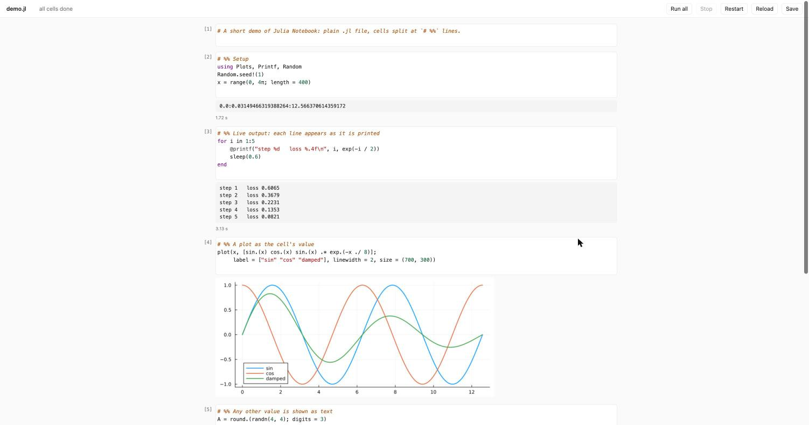

# Julia Notebook

A small, plain notebook for Julia. It opens an ordinary `.jl` file in your browser, splits it
into cells at `# %%` lines, and lets you run them one at a time and see the output underneath,
the way Jupyter does. The file stays a normal Julia script that any editor, `include`, or git
can use.



There is no account to log into, no AI assistant, no code completion and no plugin system:
an editor per cell, a run button, and the output. If your code is increasingly written by an
AI agent of your own choosing, what you need from a notebook is to read it, run it and look
at the results, and that is all this does.

## What it does

- **Cells from plain text.** Every line starting with `# %%` begins a new cell (the same
  convention as VS Code, Zed, Spyder and Jupytext). Text after `# %%` is the cell's title.
- **Live output.** What a cell prints appears as it is printed, so a training loop's progress
  shows up line by line.
- **Results inline.** A cell's last value is shown below it: plots as images, tables as HTML,
  anything else as text. `display(...)` works too. End a cell with `;` to hide its value.
- **Stop and Restart.** Stop interrupts a running cell; Restart gives you a fresh Julia.
- **Errors point at the file.** Line numbers in error messages are the real line numbers in
  your `.jl` file.
- **Saves itself.** Edits are saved a second after you stop typing. If the file is changed by
  another program (another editor, or an agent) while you have edits open, it will not
  overwrite that change; it asks you to reload or overwrite.
- **Close the window to quit.** Closing the browser window saves, and stops everything.
- **Works offline.** Nothing is loaded from the internet; the editor
  ([CodeMirror 5](https://codemirror.net/5/)) is included.

## Install

You need [Julia](https://julialang.org/downloads/) 1.10 or later on your `PATH`.

```sh
git clone https://github.com/compleathorseplayer/JuliaNotebook.git
```

Then put the `jnb` command on your `PATH`, for example:

```sh
ln -s "$PWD/JuliaNotebook/bin/jnb" ~/.local/bin/jnb      # macOS / Linux
```

On Windows, add `JuliaNotebook\bin` to your `PATH` (it contains `jnb.cmd`).

The first time you run it, it installs its two dependencies (HTTP.jl and JSON3.jl) into its
own environment, which takes a minute or so. It does not add anything to your own Julia
environments.

## Use

```sh
jnb analysis.jl
```

This opens the notebook in your browser. If the file doesn't exist, it is created.

| Key | Action |
|---|---|
| Shift-Enter | Run the cell and move to the next one |
| Cmd/Ctrl-Enter | Run the cell and stay |
| Cmd/Ctrl-. | Stop the running cell |
| Cmd/Ctrl-S | Save now (it also saves by itself) |
| Cmd/Ctrl-/ | Comment or uncomment lines |
| Up / Down at the edge of a cell | Move into the neighbouring cell |

Each cell also has buttons to run it, add a cell below, or delete it. The top bar has
**Run all** (stops at the first error), **Stop**, **Restart**, **Reload** and **Save**.

A file looks like this:

```julia
# %% Load
using Plots
x = range(0, 2π; length = 200)

# %% Plot
plot(x, sin.(x))
```

## Which packages your code can use

Your cells run in a separate Julia process, started in the notebook file's folder. If that
folder (or one above it) has a `Project.toml`, that project is used; otherwise your default
Julia environment is. So a notebook sees the same packages as `julia` started in that folder
would.

## How it works

`jnb` starts a small web server on your computer (reachable only from your own machine, and
protected by a random token in the URL) and opens the page in your browser. The server
starts a second Julia process, the worker, which runs your cells. What the worker prints is
passed to the page as it arrives, so output streams; Stop sends the worker an interrupt;
Restart replaces it with a new one. Keeping your code out of the server process is what keeps
the page responsive while a long cell runs.

About 900 lines in all: `src/Jnb.jl` (server), `src/worker.jl` (runs cells, uses only
Julia's standard library), `assets/index.html` (the page).

## Limitations

- **Stop can't interrupt a loop that never allocates memory** (a tight numeric loop): Julia
  only checks for interrupts at certain points. If a cell doesn't respond within 3 seconds,
  the Stop button becomes **Force stop**, which restarts Julia. Jupyter's Julia kernel has the
  same limitation.
- **Stop doesn't work on Windows**, which has no way to send the interrupt; use Restart.
- Code that reads from standard input (`readline()`) won't work in a cell.
- One notebook per `jnb` command; run it again (it picks a free port) for another file.
- Developed and tested on macOS with Julia 1.12. The Linux and Windows launchers are
  included but have not been tested yet.

## Licence

MIT, see [LICENSE](LICENSE). CodeMirror is included under its own MIT licence,
[assets/LICENSE-CodeMirror](assets/LICENSE-CodeMirror).
